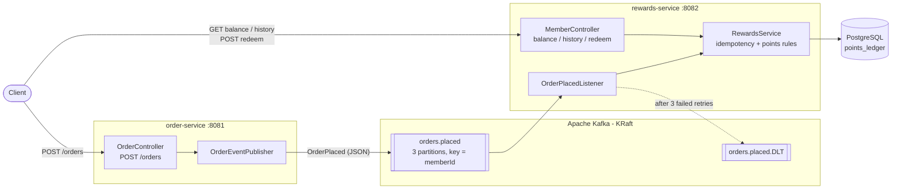

# Loyalty Rewards Platform

A small loyalty and rewards system built as two event-driven microservices.
Placing an order earns points; points can be viewed and redeemed.

- **order-service** accepts orders over REST and publishes an `OrderPlaced` event to Kafka.
- **rewards-service** consumes those events, calculates points, keeps a points ledger in
  PostgreSQL, and serves balance, history and redeem APIs.

**Tech stack:** Java 17, Spring Boot 3, Maven, Apache Kafka (KRaft mode, no Zookeeper),
PostgreSQL, Flyway, Docker Compose, JUnit 5, Mockito, Testcontainers, Spring Boot Actuator,
springdoc OpenAPI (Swagger UI), GitHub Actions.

## Architecture



### What happens when an order is placed

1. The client sends `POST /orders` to order-service.
2. order-service validates the request, builds an `OrderPlaced` event and sends it to the
   `orders.placed` topic, using the member id as the message key.
3. It waits for Kafka to confirm, then answers `202 Accepted`.
4. rewards-service reads the event and checks whether its `eventId` is already in the ledger.
5. If not, it calculates the points and inserts one row into `points_ledger`.
6. The balance is the sum of the member's ledger rows.

### Points rules

| Category | Points |
|---|---|
| `TRAVEL` | 2 points per full Rs 100 |
| `DINING` | 3 points per full Rs 100 |
| anything else (`GROCERY`, `SHOPPING`, `OTHER`) | 1 point per full Rs 100 |

The amount is rounded down to full hundreds first, then multiplied:
Rs 250 `TRAVEL` earns 2 x 2 = 4 points, and Rs 99.99 earns 0.

## How to run

**You need:** Docker Desktop (running), JDK 17 or newer, Maven 3.9+.

### 1. Start Kafka and PostgreSQL

```bash
docker compose up -d
docker compose ps        # wait until both show "healthy"
```

### 2. Start the two services (one terminal each)

```bash
mvn -pl rewards-service spring-boot:run
```

```bash
mvn -pl order-service spring-boot:run
```

| Service | URL | Swagger UI | Health |
|---|---|---|---|
| order-service | http://localhost:8081 | http://localhost:8081/swagger-ui.html | http://localhost:8081/actuator/health |
| rewards-service | http://localhost:8082 | http://localhost:8082/swagger-ui.html | http://localhost:8082/actuator/health |

### 3. Stop everything

Press `Ctrl+C` in both service terminals, then:

```bash
docker compose down      # add -v to also delete the database data
```

## Try it with curl

The commands below are for bash (Git Bash, WSL, macOS, Linux).
In PowerShell, use `curl.exe` and escape the inner quotes, for example:
`curl.exe -i -X POST http://localhost:8081/orders -H "Content-Type: application/json" -d '{\"orderId\":\"ORD-1\",\"memberId\":\"M-42\",\"amount\":2500,\"category\":\"TRAVEL\"}'`

**Place two orders**

```bash
curl -i -X POST http://localhost:8081/orders \
  -H "Content-Type: application/json" \
  -d '{"orderId":"ORD-1","memberId":"M-42","amount":2500,"category":"TRAVEL"}'

curl -i -X POST http://localhost:8081/orders \
  -H "Content-Type: application/json" \
  -d '{"orderId":"ORD-2","memberId":"M-42","amount":1000,"category":"DINING"}'
```

Each returns `202 Accepted`:

```json
{"orderId":"ORD-1","eventId":"35d44a60-54c4-36e0-9542-885cbe0d28c5","status":"ACCEPTED"}
```

**Check the balance** (50 + 30 points)

```bash
curl http://localhost:8082/members/M-42/balance
```

```json
{"memberId":"M-42","balance":80}
```

**See the history** (newest first)

```bash
curl http://localhost:8082/members/M-42/history
```

**Redeem points**

```bash
curl -i -X POST http://localhost:8082/members/M-42/redeem \
  -H "Content-Type: application/json" \
  -d '{"points":30}'
```

```json
{"memberId":"M-42","redeemedPoints":30,"balance":50}
```

**Redeem more than the balance** returns `409 Conflict`:

```bash
curl -i -X POST http://localhost:8082/members/M-42/redeem \
  -H "Content-Type: application/json" \
  -d '{"points":100000}'
```

```json
{
  "type": "about:blank",
  "title": "Insufficient balance",
  "status": 409,
  "detail": "Insufficient balance: requested 100000 points, available 50",
  "instance": "/members/M-42/redeem",
  "requested": 100000,
  "available": 50
}
```

## API reference

### order-service

| Method | Path | Success | Errors |
|---|---|---|---|
| `POST` | `/orders` | `202` order accepted, event published | `400` invalid request, `503` Kafka unavailable |

Request fields: `orderId` (text, required), `memberId` (text, required),
`amount` (greater than 0, at most 2 decimals), `category`
(`TRAVEL`, `DINING`, `GROCERY`, `SHOPPING` or `OTHER`).

### rewards-service

| Method | Path | Success | Errors |
|---|---|---|---|
| `GET` | `/members/{id}/balance` | `200` current balance | `404` unknown member |
| `GET` | `/members/{id}/history` | `200` ledger entries, newest first | `404` unknown member |
| `POST` | `/members/{id}/redeem` | `200` new balance | `400` invalid request, `404` unknown member, `409` balance too low |

A member is "known" once they have earned points at least once.
All errors use the Problem Details JSON format (RFC 9457).

## Tests

```bash
mvn verify
```

This needs Docker running, because the integration and end-to-end tests start their own
throwaway Kafka and PostgreSQL with Testcontainers. They never use the containers from
`docker-compose.yml`.

| Level | What it checks | Where |
|---|---|---|
| Unit | Points rules (written test-first), earn and redeem rules, with mocks and no Spring | `PointsCalculatorTest`, `RewardsServiceTest` |
| Component | Controllers only (`@WebMvcTest`): JSON, validation, HTTP status codes | `OrderControllerTest`, `MemberControllerTest` |
| Integration | One service with real Kafka and PostgreSQL: idempotency, retries, dead-letter topic, concurrent redemptions | `OrderPublishingIntegrationTest`, `OrderPlacedConsumerIntegrationTest`, `MemberApiIntegrationTest` |
| End-to-end | Both real jars running as separate processes: place orders, watch the balance grow, redeem | `LoyaltyEndToEndIT` in `e2e-tests` |

`mvn test` runs everything except the end-to-end test, which needs the packaged jars.

## Continuous integration

`.github/workflows/ci.yml` runs `mvn verify` on every push and pull request,
on an Ubuntu runner with Java 17.

## Design decisions and trade-offs

### Why Kafka between the services, instead of a REST call?

- **Decoupling.** order-service does not know rewards-service exists. If rewards-service is
  down, orders are still accepted and the events wait in the topic until it is back.
- **Replay.** Events stay in the topic, so a new consumer (for example fraud checks or
  analytics) can be added later without touching order-service.
- **Trade-off:** the system is eventually consistent. Points appear a moment after the
  order is accepted, which is why `POST /orders` returns `202 Accepted` and not `201`.
  It is also more infrastructure to run than a direct call.

### Why an idempotent consumer?

Kafka delivers each message **at least once**: after a crash or a rebalance the same message
can arrive again. Clients can also retry an HTTP request. Without protection, a member
would get points twice.

- order-service derives the `eventId` from the `orderId`, so a retried order produces the
  same `eventId`.
- rewards-service checks the ledger for that `eventId` before inserting.
- A `UNIQUE` constraint on `points_ledger.event_id` is the final guard: if two threads
  pass the check at the same moment, the database lets only one insert succeed.
- **Trade-off:** one extra lookup per event, and `orderId` must be unique across members.

### Why a dead-letter topic?

Kafka will not move past a message that keeps failing, so one bad message would block its
partition forever.

- A failing message is retried 3 times, one second apart. This covers short outages such
  as a database restart.
- After that it is published to `orders.placed.DLT` with headers describing the error,
  and the consumer continues with the next message.
- Messages that can never succeed (unreadable JSON, a missing field) skip the retries.
- **Trade-off:** a dead-lettered event awards no points until someone inspects and replays
  it. There is no automatic replay in this project.

### Other decisions

- **Message key = member id.** Kafka keeps order only inside a partition, and the same key
  always goes to the same partition, so one member's orders are processed in order.
- **Publish, then answer.** order-service waits for Kafka's confirmation (`acks=all`)
  before answering `202`, and answers `503` if Kafka is unavailable. This is slower than
  fire-and-forget, but an accepted order is never silently lost.
- **Append-only ledger.** Rows are never updated; the balance is `SUM(points)`. This gives
  a full audit trail. The trade-off is that the sum gets slower as a member's history grows;
  a cached balance column would be the next step.
- **No double spending.** A redemption takes a PostgreSQL advisory lock on the member inside
  its transaction, so two simultaneous redemptions cannot both spend the same points.
- **Flyway owns the schema.** Hibernate runs with `ddl-auto: validate`, so it only checks
  that the entities match the tables and never changes them.
- **No shared code between the services.** Each has its own `OrderPlacedEvent` class. The
  contract is the JSON, and the consumer ignores fields it does not know.

### Known limitations

- There is no authentication; any caller can read or redeem any member's points.
- order-service does not store orders. It only validates and publishes them.
- Redemptions are not idempotent: retrying a `POST /redeem` redeems twice.
- The history endpoint has no pagination.
- Kafka runs as a single broker with replication factor 1, which is fine for local use only.
- The services run from Maven, not as Docker images; `docker compose up` starts only
  Kafka and PostgreSQL.

## Project layout

```
loyalty-rewards-platform/
├── pom.xml                 parent POM (versions, module list)
├── docker-compose.yml      Kafka (KRaft) and PostgreSQL for local runs
├── order-service/          REST API + Kafka producer
├── rewards-service/        Kafka consumer + points ledger + REST API
├── e2e-tests/              end-to-end test that runs both jars
└── .github/workflows/      CI pipeline
```
